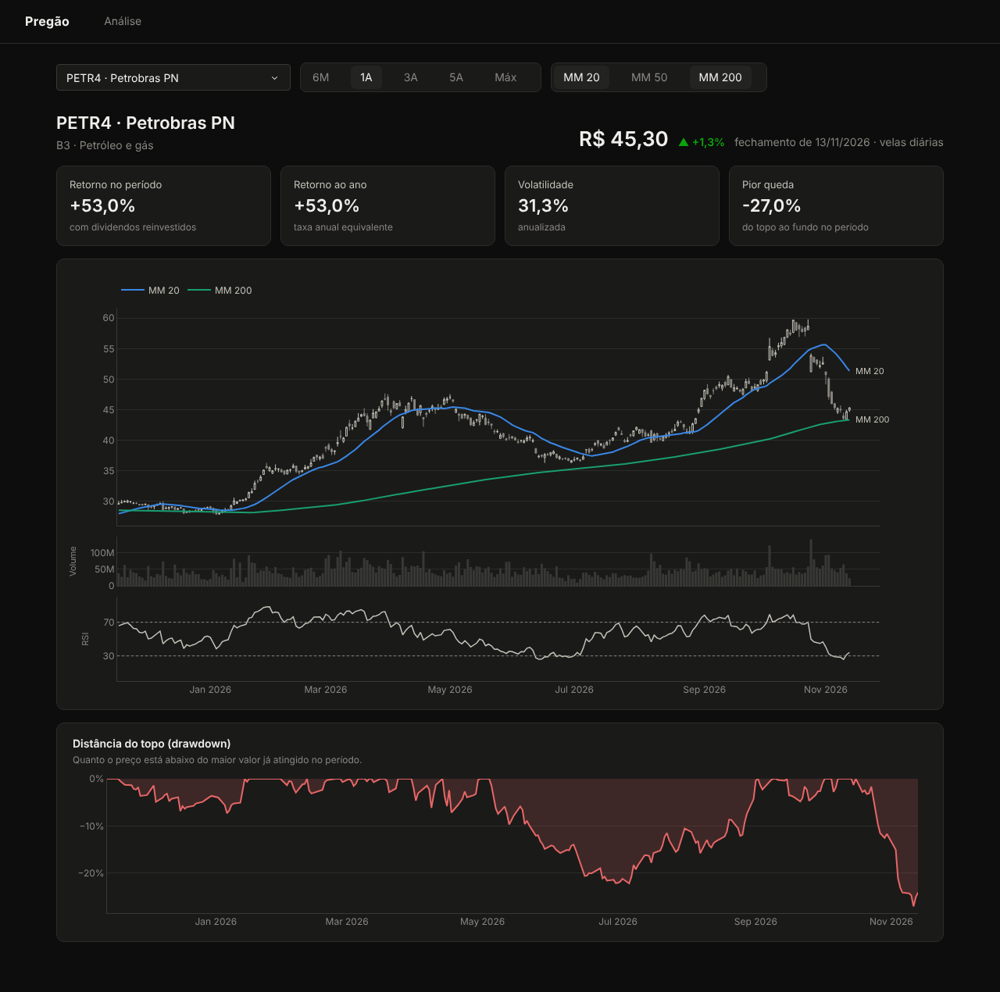

# Pregão

Painel para visualizar ações da B3 e dos EUA e testar modelos de previsão de forma honesta: cada modelo é comparado com uma baseline ingênua num backtest walk-forward, e o erro aparece na tela, inclusive quando o modelo perde.

> Em construção. O projeto está sendo feito por partes; cada parte tem seus commits.



## Telas

- **Análise** (pronta): velas com médias móveis de 20, 50 e 200 dias, volume, RSI, drawdown e as estatísticas do período (retorno, retorno anualizado, volatilidade e pior queda). As velas e as médias usam preços ajustados por dividendos e desdobramentos.
- **Comparação** (próxima)
- **Previsão** (depois): modelos contra uma baseline ingênua, em backtest walk-forward.

## Como os dados chegam

```
pregao/tickers.py ──► GitHub Actions (seg a sex, depois do fechamento da B3)
                         │  scripts/update_data.py baixa o histórico no Yahoo Finance
                         │  se um ticker falhar, mantém os dados antigos dele
                         ▼
                      data/prices.parquet ──► app Dash (só lê o arquivo)
```

O app nunca chama o Yahoo Finance diretamente. O yfinance não é uma API oficial e sofre com rate limit, então os dados são baixados uma vez por dia e ficam versionados no repositório.

## Rodando localmente

Python 3.11+:

```bash
python -m venv .venv
source .venv/bin/activate        # Windows: .venv\Scripts\activate
pip install -r requirements-dev.txt
python scripts/update_data.py    # opcional: os dados já vêm no repositório
python -m pregao.app             # http://127.0.0.1:8050
pytest
```

## Estrutura

```
pregao/
  tickers.py      lista de ativos acompanhados
  data.py         download, limpeza e cache dos preços (usado pelo robô)
  store.py        leitura dos preços pelo app, com cache em memória
  indicators.py   retornos, médias móveis, RSI, volatilidade, drawdown
  analysis.py     prepara um ativo para a tela: ajuste, recorte, velas semanais/mensais
  theme.py        cores e estilo dos gráficos
  charts.py       figuras Plotly
  app.py          app Dash e navegação
  pages/          uma tela por arquivo
  assets/         CSS (carregado automaticamente pelo Dash)
scripts/          update_data.py, rodado pelo GitHub Actions
tests/
```
