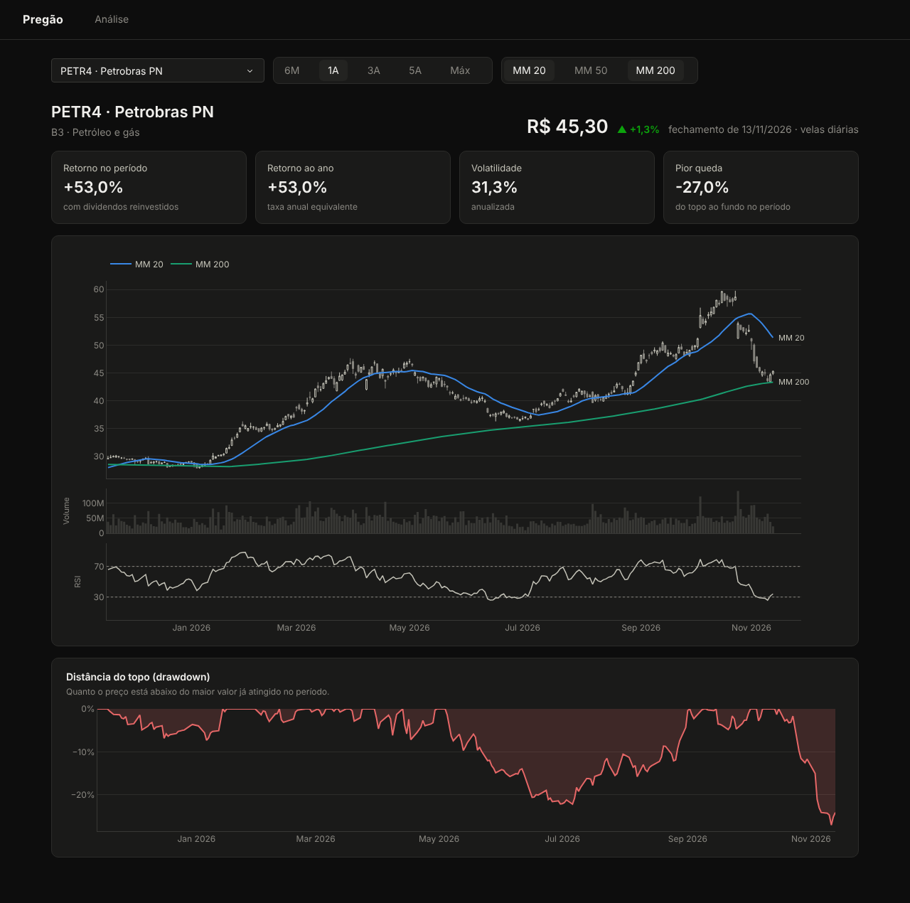
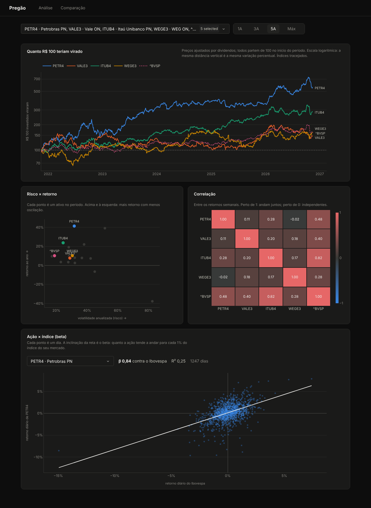
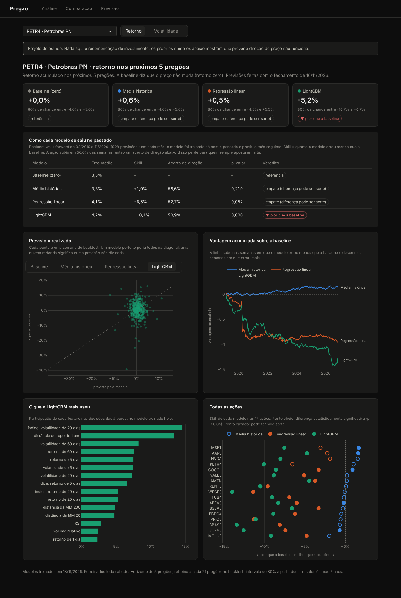

# Pregão

Painel para visualizar ações da B3 e dos EUA e testar modelos de previsão de forma honesta: cada modelo é comparado com uma baseline ingênua num backtest walk-forward, e o erro aparece na tela, inclusive quando o modelo perde.

> Em construção. O projeto está sendo feito por partes; cada parte tem seus commits.







## Telas

- **Análise** (pronta): velas com médias móveis de 20, 50 e 200 dias, volume, RSI, drawdown e as estatísticas do período (retorno, retorno anualizado, volatilidade e pior queda). As velas e as médias usam preços ajustados por dividendos e desdobramentos.
- **Comparação** (pronta): até 6 ativos lado a lado. Quanto R$ 100 teriam virado em cada um (escala log), risco × retorno de todos os ativos acompanhados, correlação entre retornos semanais e o beta de uma ação contra o índice do seu mercado.
- **Previsão** (pronta): a previsão de cada modelo para os próximos 5 pregões, com intervalo de 80%; a tabela do backtest com erro, skill, acerto de direção e p-valor; previsto × realizado; a vantagem acumulada de cada modelo sobre a baseline ao longo do tempo; as features que o LightGBM mais usa; e o resumo das 17 ações.

## Previsão: o que foi testado e o que deu

Para cada uma das 17 ações, dois alvos nos próximos **5 pregões**: o **retorno** e a **volatilidade**.
Quatro modelos por alvo, todos medidos contra uma baseline ingênua:

| | Retorno | Volatilidade |
|---|---|---|
| Baseline | zero ("o preço não muda") | a volatilidade do último mês |
| Média histórica | média dos retornos passados | média (geométrica) da volatilidade passada |
| Regressão linear | Ridge sobre 15 features | Ridge, treinada no log do alvo |
| LightGBM | gradient boosting sobre 15 features | gradient boosting, treinado no log do alvo |

As features usam só informação disponível no fechamento do dia: retornos e volatilidades em várias janelas, RSI, distância das médias de 20 e 200 dias, distância do topo de 1 ano, volume relativo e o comportamento do índice do mercado (Ibovespa ou S&P 500).

**Como é medido.** Backtest walk-forward: treina com 3 anos, prevê o mês seguinte, retreina com o mês incluído e repete até hoje. Entre o fim do treino e o início do teste há um intervalo de 5 dias, porque o alvo de cada dia depende dos 5 dias seguintes; sem ele, o treino conteria informação do período de teste. Métricas: erro absoluto médio (MAE), *skill* (`1 − erro do modelo / erro da baseline`), acerto de direção comparado à taxa de semanas de alta, e o teste de Diebold-Mariano para saber se a diferença para a baseline é estatisticamente significativa ou pode ser sorte.

**Resultado da primeira rodada (novembro de 2026):**

- **Retorno:** nenhum modelo supera "prever zero". O LightGBM é significativamente *pior* nas 17 ações (skill de −5% a −14%): ele encontra padrões no ruído do treino que não se repetem. O acerto de direção fica perto de 50%, abaixo de simplesmente apostar que a ação sobe.
- **Volatilidade:** o LightGBM erra menos que a baseline nas 17 ações (skill de +2% a +16%), com diferença significativa em 5 delas. A regressão linear ganha em 14 e também é significativa em 5. A volatilidade tem memória (períodos agitados vêm em sequência), e é isso que os modelos capturam; mas a baseline "último mês" já captura boa parte dessa memória, então o ganho é modesto.

O gráfico de vantagem acumulada mostra uma nuance que a média esconde: boa parte do ganho na volatilidade veio de um único período, a pandemia (2020-2021), quando a volatilidade mudou de patamar muito rápido e a baseline "último mês" ficou para trás. Fora desses choques, a vantagem é pequena.

Prever a direção do preço é praticamente impossível com dados públicos de preço; prever o *risco* é possível, com ganho real mas pequeno. Os números são recalculados toda semana.

**Decisões que ficaram de fora.** O ARIMA, previsto no plano inicial, foi substituído pela regressão linear: num walk-forward diário ele precisaria ser reajustado a cada dia, e em retornos diários costuma terminar equivalente a prever zero, que já é a baseline. Também foi testada a volatilidade de 21 dias, que não melhorou; as variações testadas foram mantidas no mínimo para não ajustar o modelo ao próprio backtest.

## Como os dados chegam

```
pregao/tickers.py ──► GitHub Actions (seg a sex, depois do fechamento da B3)
                         │  scripts/update_data.py baixa o histórico no Yahoo Finance
                         │  se um ticker falhar, mantém os dados antigos dele
                         ▼
                      data/prices.parquet ──► app Dash (só lê os arquivos)
                         │                          ▲
                         ▼                          │
   GitHub Actions (sábado) ── scripts/train_models.py ──► data/ml/
```

O app nunca chama o Yahoo Finance diretamente. O yfinance não é uma API oficial e sofre com rate limit, então os dados são baixados uma vez por dia e ficam versionados no repositório.

## Rodando localmente

Python 3.11+:

```bash
python -m venv .venv
source .venv/bin/activate        # Windows: .venv\Scripts\activate
pip install -r requirements-dev.txt
python scripts/update_data.py    # opcional: os dados já vêm no repositório
python -m pregao.app             # http://127.0.0.1:8050
python scripts/train_models.py  # ~5 min: backtest de todos os modelos
pytest
```

## Estrutura

```
pregao/
  tickers.py      lista de ativos acompanhados
  data.py         download, limpeza e cache dos preços (usado pelo robô)
  store.py        leitura dos preços pelo app, com cache em memória
  indicators.py   retornos, médias móveis, RSI, volatilidade, drawdown
  analysis.py     prepara um ativo para a tela: ajuste, recorte, velas semanais/mensais
  comparison.py   vários ativos: normalização, risco × retorno, correlação, beta
  forecast.py     resume os resultados do ML para a tela de previsão
  theme.py        cores e estilo dos gráficos
  charts.py       figuras Plotly
  ui.py           peças de interface usadas por mais de uma página
  ml/
    features.py   features e alvos, sem informação do futuro
    models.py     baselines, média histórica, Ridge, LightGBM
    backtest.py   walk-forward com intervalo entre treino e teste
    metrics.py    MAE, skill, acerto de direção, Diebold-Mariano
    train.py      roda tudo e salva em data/ml/
  app.py          app Dash e navegação
  pages/          uma tela por arquivo
  assets/         CSS (carregado automaticamente pelo Dash)
scripts/          update_data.py (diário) e train_models.py (semanal), rodados pelo GitHub Actions
tests/
```
